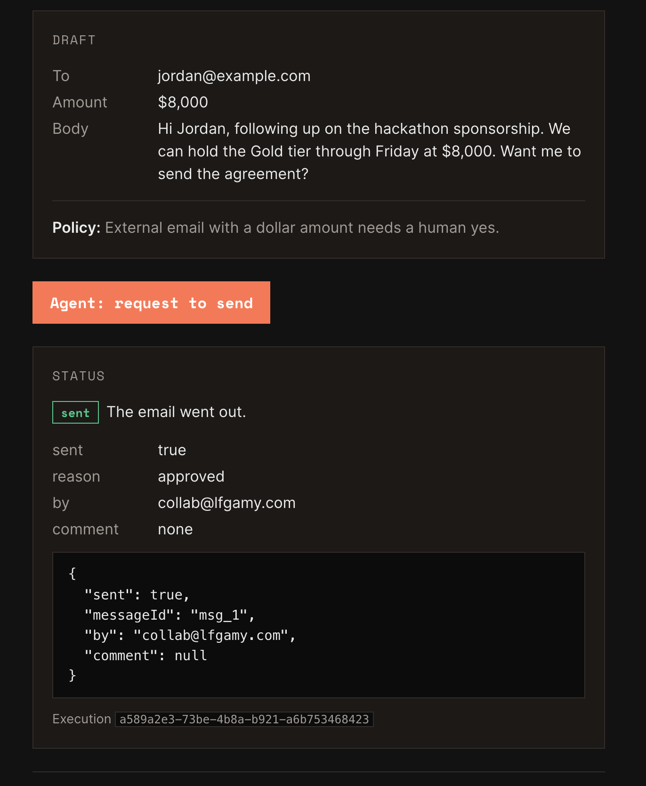

# Approve to act

A cookbook recipe for [Volcano](https://volcano.dev): an agent drafts an outbound email, a durable function holds it with no compute running until a person approves or denies it from the CLI or dashboard, then it sends or archives. One durable function, one Next.js page, one coding-agent prompt.

**Live demo:** https://6d15babd-0568-426f-a24b-91fa5b195bde.frontends.volcano.run/

## How it works

1. The page starts the `send-outbound` durable function with the draft as input.
2. The function saves the draft, then calls `ctx.waitForApproval`. The execution suspends. No compute runs while it waits.
3. A person approves or denies from the CLI (`volcano cloud durable approvals approve <id> --yes`) or the dashboard. Only a signed-in person can decide; the agent cannot approve its own request.
4. The function resumes with the decision and sends or archives. The page polls and shows the result, including who decided.

- [RECIPE.md](RECIPE.md): the cookbook entry, in the format of the recipes at docs.volcano.dev/cookbooks.
- [FEEDBACK.md](FEEDBACK.md): everything that tripped me up as a first-time Volcano user, logged as it happened, with what would have fixed it.
- `volcano/functions/send-outbound/`: the durable function.
- `frontend/`: the Agent inbox page.
- `screenshots/`: dashboard and live-page captures from the build.

Built in one evening on Nov 5, 2026 with Claude Code in VS Code, Volcano CLI v0.71.0, SDK 2.2.0. Every command was run by hand; the log is real.

Made by [Amy Mayernik](https://lfgamy.com). Not affiliated with Kong or Volcano. MIT licensed.
