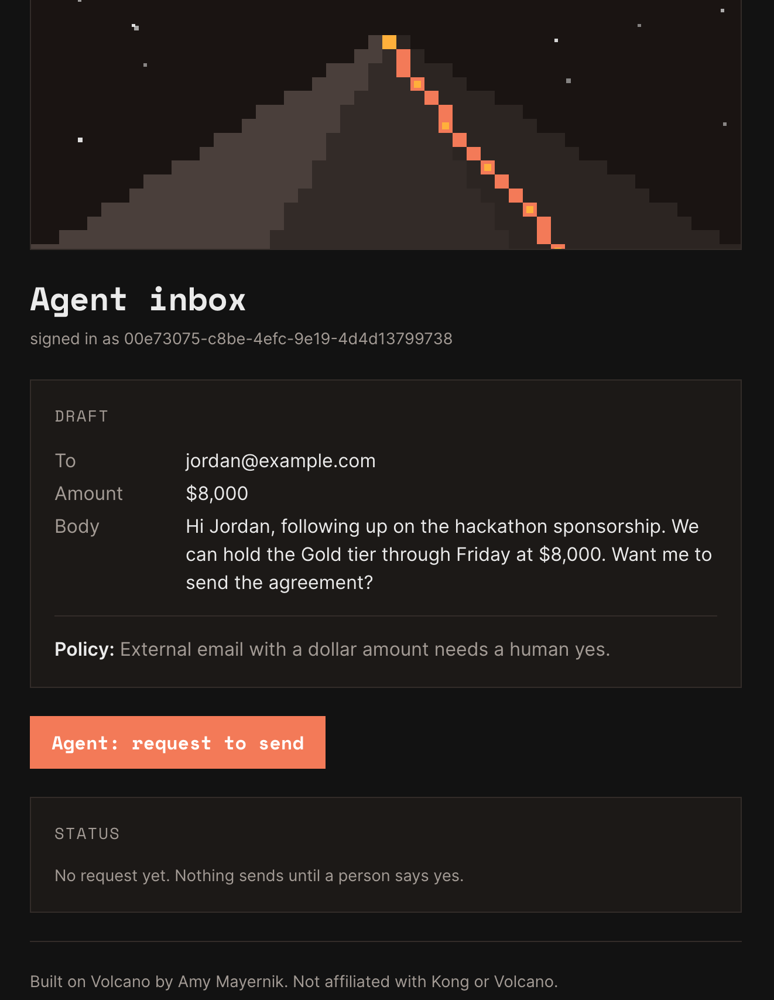
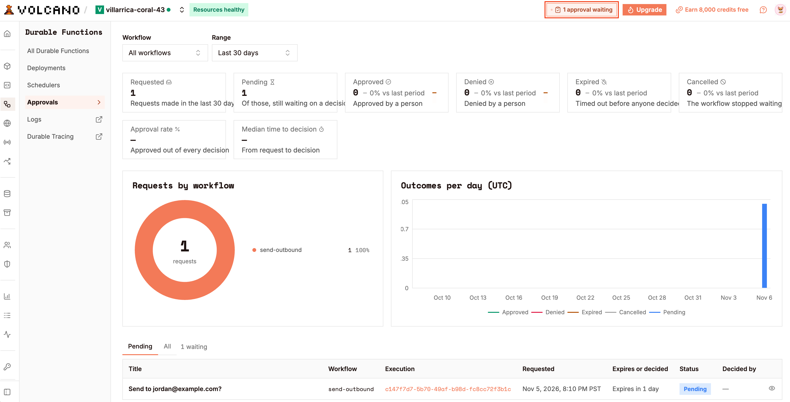
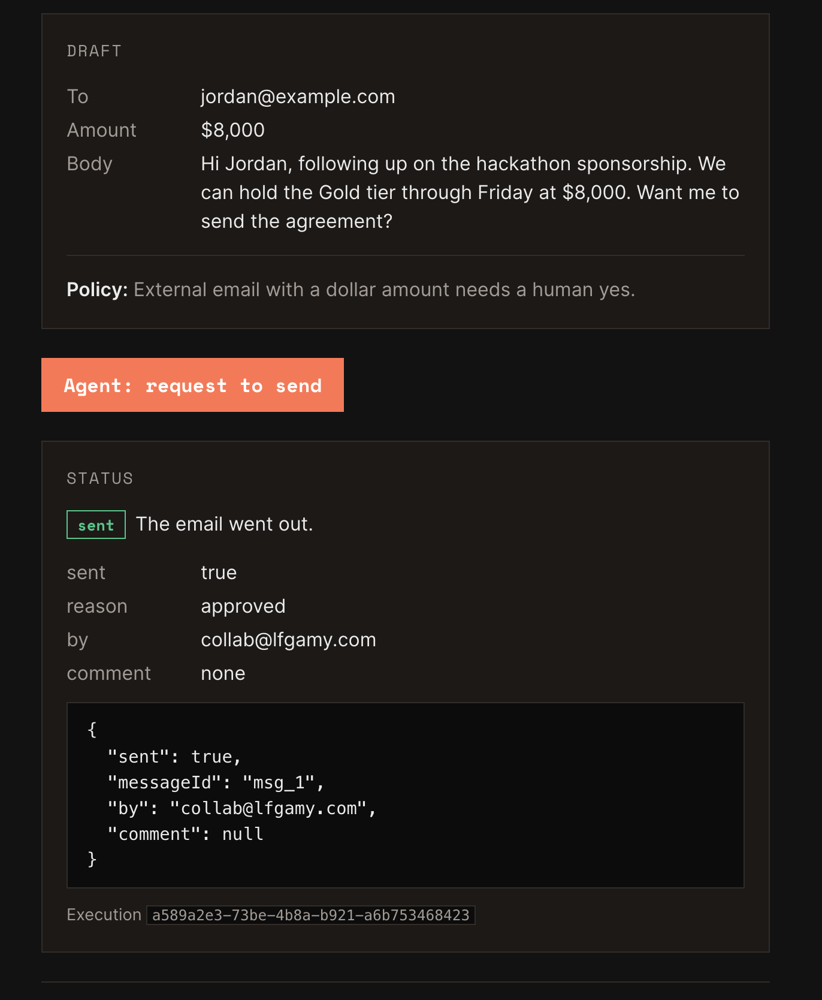

# Approve to act

An agent drafts an outbound email. A durable function holds it, with no compute running, until a person approves or denies it from the CLI or the dashboard. Then it sends or archives. One durable function, one Next.js page, one coding-agent prompt.

## What it does

A visitor to the Agent inbox page signs in anonymously and asks to send a draft email that contains a dollar amount. The `send-outbound` durable function saves the draft, calls `ctx.waitForApproval`, and suspends. The request appears in the project's Approvals page and in `volcano cloud durable approvals list`. A person approves or denies it. The execution resumes on the next line with the decision and either sends the email or archives the draft. The page polls the execution and shows the result, including who decided and their comment.







## What you need

- The Volcano CLI (tested on v0.71.0), signed in, with a project on the free tier. Docker Desktop running for local development.
- Node 22 or later. `@volcano.dev/sdk` 2.2.0. Next.js 16.

## Build it with your coding agent

Paste this into Claude Code in an empty folder. It was tested with the Volcano plugin for Claude Code (`volcano setup --agent claude-code`, plugin 0.2.49) installed.

```text
Build "approve-to-act" on Volcano.

Backend:
- A durable function `send-outbound` in volcano/functions/send-outbound/index.js, wrapped with `durable` from `@volcano.dev/sdk/durable`, with its own package.json depending on @volcano.dev/sdk.
- It saves the input draft in a step named `save-draft`, then calls ctx.waitForApproval('send-outbound', { title, description, details, timeout: '24h' }).
- On approved: a `send` step (stub sendEmail) and return { sent: true, by: decision.decidedBy.email, comment }.
- On denied or expired: an `archive` step and return { sent: false, reason: decision.status, comment }. Never throw on denial.
- volcano/volcano-config.yaml with `version: 1`, the function declared `kind: durable` and `visibility: authenticated`, and `auth.signup.enable_anonymous_signins: true`.

Frontend:
- A Next.js App Router page under frontend/ that signs the visitor in anonymously with the SDK, shows one hard-coded draft, and a button that calls volcano.durable.start('send-outbound', input, { executionName: 'draft-' + Date.now() }).
- Poll the execution every 3 seconds with the credential that started it and show running / sent / not sent / failed. Never use the service key in the frontend.
- .volcano/source-layout.json listing the frontend with workspace "frontend".

Do not invent SDK methods. If a method is not in the volcano-sdk skill or docs.volcano.dev/llms.txt, stop and say so.

Acceptance tests, run before you finish:
1. `volcano start` then `volcano deploy` succeed.
2. Starting an execution leaves it `running` with one pending approval in `volcano durable approvals list`.
3. `volcano durable approvals approve <id> --yes` resumes it; the result has sent: true.
4. A second execution denied with a comment returns sent: false, reason: "denied", and status succeeded, not failed.
```

How it was tested: Claude Code (Fable 5.1) in VS Code on macOS, Volcano CLI v0.71.0, SDK 2.2.0, plugin 0.2.49, Next.js 16.4.5, Node 25. The backend was built by hand first, then the frontend from a prompt like the one above. Claude Code read the Volcano skills before writing, found on its own that `durable.getFromApplication` is in the docs but not in SDK 2.2.0, and used the documented REST read instead. Tests 1 to 4 passed by hand locally and in the cloud. The prompt above has not yet been run from an empty folder end to end; that run and its timing will be added here.

## Build it yourself

Install and sign in, then scaffold and start the local server. Local development needs Docker running; `volcano doctor` checks it.

```bash
npm install -g @volcano.dev/cli
volcano signup            # or: volcano login
volcano init
volcano doctor
volcano start
```

Gotcha: if you sign up on volcano.dev first, the site hands you a `volcano connect --device-code …` command instead. Running it inside an existing folder creates a subfolder named after the project. Run it in the folder you want linked, or move `.volcano/`, `AGENTS.md` and `volcano/cloud.env` up afterwards.

### The durable function

Create `volcano/functions/send-outbound/index.js`. The SDK must be a dependency of the function folder: the deploy packs that folder and installs from its `package.json` at build time.

```bash
mkdir -p volcano/functions/send-outbound && cd volcano/functions/send-outbound
npm init -y && npm install @volcano.dev/sdk
cd ../../..
```

```javascript
// volcano/functions/send-outbound/index.js
const { durable } = require('@volcano.dev/sdk/durable');

function saveDraft(input) { return { id: 'draft_' + Date.now() }; }
function archiveDraft(id, status) {}
function sendEmail(input) { return { messageId: 'msg_1' }; }

exports.handler = durable(async (input, ctx) => {
  const draft = await ctx.step('save-draft', () => saveDraft(input));

  const decision = await ctx.waitForApproval('send-outbound', {
    title: `Send to ${input.to}?`,
    description: 'External email with a dollar amount. Policy requires a person to approve.',
    details: { draft_id: draft.id, to: input.to, amount: input.amount, preview: String(input.body || '').slice(0, 200) },
    timeout: '24h',
  });

  if (!decision.approved) {
    // 'denied' and 'expired' are results, not errors.
    await ctx.step('archive', () => archiveDraft(draft.id, decision.status));
    return { sent: false, reason: decision.status, comment: decision.comment || null };
  }

  const sent = await ctx.step('send', () => sendEmail(input));
  return { sent: true, messageId: sent.messageId, by: decision.decidedBy && decision.decidedBy.email, comment: decision.comment || null };
});
```

Gotcha: `decision.approved` is false for both `denied` and `expired`, and neither throws. Code that wraps the wait in try/catch to "handle denial" handles nothing; branch on the result.

### The manifest

```yaml
# volcano/volcano-config.yaml
version: 1

auth:
  signup:
    enable_anonymous_signins: true   # off by default; the page signs visitors in anonymously

functions:
  - name: send-outbound
    kind: durable
    visibility: authenticated        # signed-in users, anonymous included, may start it

frontends:
  - name: agent-inbox
    variable_scope: scoped
    variables:
      - NEXT_PUBLIC_VOLCANO_API_URL
      - NEXT_PUBLIC_VOLCANO_ANON_KEY
```

Gotcha: `version: 1` is required and the functions list uses `- name:` entries. Fields like `runtime` and `handler` are not accepted; the runtime is inferred from the file extension. `volcano config pull` shows the exact shape the server expects.

Run it locally and approve from the CLI:

```bash
volcano durable deploy --all
volcano config deploy
volcano durable start send-outbound --input '{"to":"jordan@example.com","amount":8000,"body":"Hi Jordan, we can hold the Gold tier through Friday at $8,000."}'
volcano durable approvals list --status pending
volcano durable approvals approve <approval-id> --comment "looks good" --yes
volcano durable executions get send-outbound <execution-id>
```

Gotcha: `start` prints an `ID` and a `Name`; `executions get` wants the ID, `approvals list` shows the Name. Approval timeouts run in real time even locally (set `timeout: '10s'` once to watch `expired` come back), while `ctx.wait` resolves instantly under `volcano start`.

### The page

The page is a client component. It signs in with `volcano.auth.signInAnonymously()`, starts the execution with `volcano.durable.start(...)`, keeps `data.id` and `data.client_token`, and polls. The full source is in `frontend/`; the part that matters:

```ts
const { data, error } = await volcano.durable.start(
  'send-outbound',
  { to, amount, body },
  { executionName: 'draft-' + Date.now() },
);
// data.id, data.client_token

// Poll with the credential that started it. SDK 2.2.0 does not ship
// durable.getFromApplication, which the docs describe, so this sends the
// documented REST read until it does:
const r = await fetch(`${apiUrl}/durable-functions/send-outbound/executions/${data.id}`, {
  headers: { Authorization: `Bearer ${session.access_token}`, 'X-Volcano-Client-Token': data.client_token },
});
```

Gotcha: anonymous sign-in is off by default on every project. Without `enable_anonymous_signins: true` the page gets `403 anonymous signins are disabled for this project`.

## Configure and deploy

Cloud values live in `volcano/cloud.env` (written by `volcano connect`; gitignored). One command deploys variables, the durable function, the frontend, and the manifest, in that order, and prints the site URL:

```bash
volcano cloud deploy --env-file volcano/cloud.env
```

Tested: 5m10s end to end, frontend archive 16KB, function active in 8 regions.

## Check that it works

Open the printed URL. You should see "signed in as" with a UUID. Click "Agent: request to send"; within three seconds the status reads "running, waiting for a person to approve." Then:

```bash
volcano cloud durable approvals list --status pending
volcano cloud durable approvals approve <approval-id> --comment "looks good" --yes
```

Within three seconds the page shows "sent" with your account email as `by` and the comment. Sample result read back from the CLI:

```text
Status: succeeded
Duration: 1m2s
Result: {
  "by": "collab@lfgamy.com",
  "comment": "looks good",
  "messageId": "msg_1",
  "sent": true
}
```

Deny one and the page shows "not sent, reason denied" with the comment; the execution still ends `succeeded`.

## Why it's built this way

- The wait costs nothing. The execution holds no compute while suspended, up to the 24h timeout here and up to 366 days by platform limit.
- Denied and expired are results, not exceptions, so the branch is explicit and testable from the CLI.
- Only a person can decide. Project access tokens get 403 and the MCP server can list but not approve, so an agent cannot approve its own request.
- Anonymous sign-in plus `visibility: authenticated` means anyone holding the anon key can start an execution. Fine for a demo; a real app validates input inside the function and watches the execution allowance.
- Decisions that come from code (a webhook, a payment provider) belong in a durable message, not an approval. This recipe keeps the two apart.
